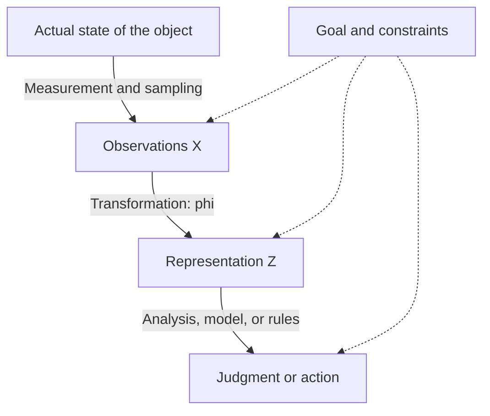
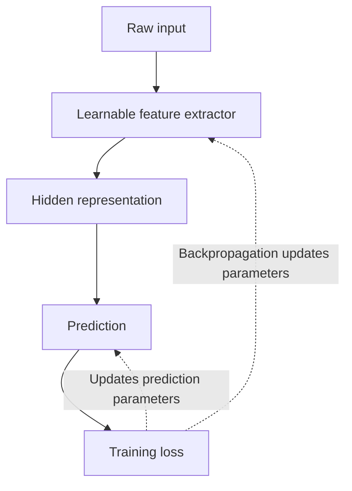
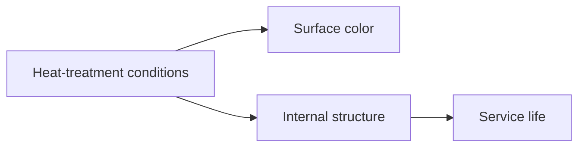
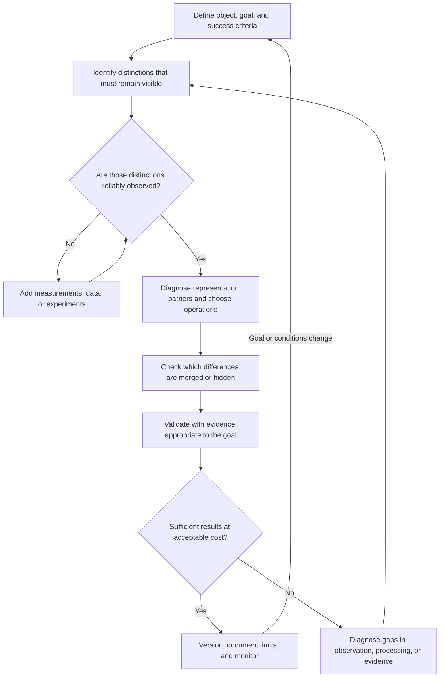
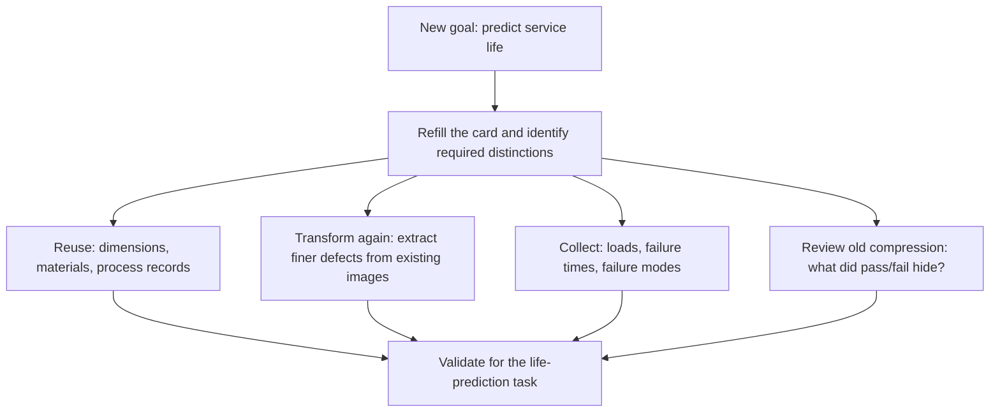
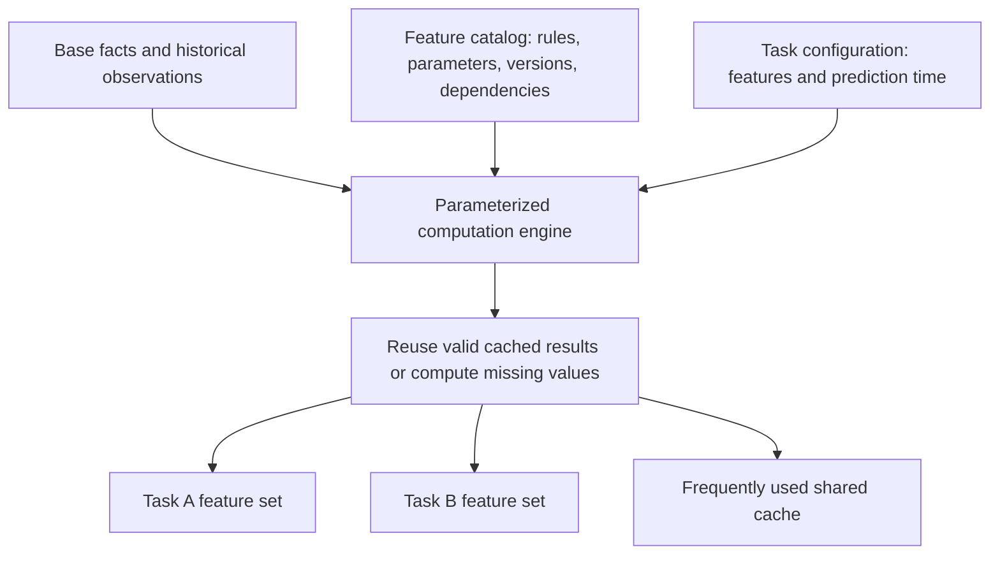

This article brings together the concepts, decision framework, and engineering practices developed in our discussion. The screw example illustrates the method; actual requirements must follow the applicable drawings, inspection specifications, and study conditions.

> First identify the differences the goal requires us to preserve, then decide how to observe and represent them. If information is missing, improve observation. If the representation is inadequate, transform it. If evidence is insufficient, improve the study design.

## 1. Dimensions, information, and representation

“Dimension” has different technical meanings across disciplines. Here, it primarily refers to the variables, coordinates, and degrees of freedom used to describe an object. The framework is a reusable decision process, not a claim that all definitions of dimension are identical.

| Concept | Meaning | Important distinction |
|---|---|---|
| Representation dimension | Number of numerical coordinates describing a sample | More features do not necessarily mean more information |
| Intrinsic dimension | Degrees of freedom needed to describe the data's variation | Can be lower than the representation dimension |
| Sample count | Number of observations | More observations do not necessarily add features |
| Data axes | Organization into samples, time, space, or channels | The number of array axes is not the number of features |
| Task-relevant information | Information needed for a particular judgment or action | Changes with the goal |

For example, representing a scalar with three coordinates adds representation dimensions:

$$
x \longmapsto [x,x^2,x^3]
$$

It adds no independent observational information. It may make a relationship that was previously difficult to express easier for a model to learn.

Separate the object, the measurement, and the representation:

*Figure 1. Measurement and representation transformation are separate stages. A deterministic transformation cannot create new observational information absent from its input; inferring an unobserved state requires additional assumptions and evidence.*

## 2. Why transform dimensions?

The same information can be easier or harder to understand, compute with, or learn from, depending on its representation.

Three motivations recur:

1. **Expose relationships.** Make an implicit relationship explicit.
2. **Reduce interference.** Remove redundancy or variation irrelevant to the goal.
3. **Align with structure.** Match coordinates, scales, adjacency, or hierarchy to the object and task.

A good representation must account for the object's structure, the research goal, and the available processing capabilities. Easier prediction, easier explanation, and causal justification are different evaluation criteria.

### 2.1 Types of dimension operations

| Operation | Purpose | Question to check |
|---|---|---|
| Add dimensions | Introduce observations or derived coordinates | Is this new evidence or a new expression of existing evidence? |
| Select dimensions | Retain a subset of features | Could a removed distinction matter? |
| Compress | Express data with fewer coordinates | Does the retained information support the goal? |
| Change coordinates or scale | Reorganize numerical expression | What relationship becomes easier to see? |
| Aggregate | Summarize across time, space, or another axis | Could important local differences disappear? |
| Restructure | Change shape, grouping, or arrangement | Are order and adjacency preserved where needed? |
| Learn a representation | Fit a transformation to a training objective | How will usefulness and limitations be tested? |

These categories overlap. Replacing seven measurements with their sum compresses the representation. Appending that sum to the original measurements expands it.

## 3. Rolling features, convolution, and learned features

### 3.1 Does a seven-day sales total increase dimensionality?

Let daily sales be x(t), and define:

$$
s_t=\sum_{k=0}^{6}x_{t-k}
$$

- If the model originally receives only today's sales, this adds historical information to its input.
- If it already receives all seven daily values, the total adds no raw information. It may still make a useful relationship easier to learn.
- If the total replaces the seven values, it generally loses the ability to distinguish their daily patterns.

For ordinary linear regression already receiving all seven values, adding their sum does not expand the space of linear functions and introduces exact collinearity. For other models, such as decision trees, a threshold on the total can be much easier to express. Regularization can also change how equivalent information is used during training.

### 3.2 The role of convolution

A fixed rolling sum is a discrete convolution. Its kernel specifies a local weighted computation; sliding repeats that computation at different positions.

| Local computation | Relationship highlighted | Limitation |
|---|---|---|
| Seven weights of 1 | Seven-day total | Does not preserve within-window order |
| Seven weights of 1/7 | Seven-day average | Can obscure abrupt changes |
| Weights [-1, 0, 1], applied in chronological order | Difference between the last and first values | Does not establish a steady increase |

Both [10, 20, 30] and [10, 100, 30] produce an endpoint difference of 20. A response is evidence about the relationship encoded by the computation; it is not a probability that a named pattern exists.

Deep learning commonly calls sliding cross-correlation “convolution,” although the strict mathematical definitions differ by kernel reversal. Rolling maxima and medians are generally not fixed-kernel linear convolutions.

### 3.3 How neural networks learn features

*Figure 2. Features do not have to be named in advance. The training objective can jointly shape the feature extractor and the prediction model.*

- **Convolutional layers:** local connections, with kernel weights shared across positions.
- **Fully connected layers:** each output typically connects to all inputs through learnable weights.
- **Attention layers:** compute matching weights from the input, then aggregate information from positions they are allowed to access.

Multiple layers combine features into further features. Convolutional receptive fields can grow with depth, while nonlinear activations allow more complex relationships than a purely linear stack.

In an ordinary fixed architecture, the number of hidden coordinates is specified in advance. Training learns how to compute those coordinates; it does not continually add physical feature columns.

Hidden representations are not necessarily uninterpretable, but they usually have no predefined business meaning. Attention weights also cannot be directly treated as final feature importance or causal effects.

## 4. Prediction and causality need different evidence

Prediction asks: **Which screws are likely to have short lives?**

Causal research asks: **Which manufacturing change would increase service life?**

Consider this hypothetical causal structure:

*Figure 3. A causal hypothesis to investigate, not an established mechanism for every screw.*

Surface color might predict a short life. Changing the color alone might have no effect on the internal structure or service life.

| Aspect | Prediction | Causal research |
|---|---|---|
| Objective | Judge unknown outcomes reliably | Estimate the effects of intervention |
| Variable selection | Use helpful information available at prediction time | Distinguish treatment, outcome, common causes, and intermediate processes |
| Main evidence | Performance on independent, relevant data | Controlled experiments or credible comparisons under explicit assumptions |

An interpretable feature is not automatically a cause. Neural networks can assist causal estimation, but the causal claim comes from the study design and assumptions, not from network complexity or predictive accuracy.

Likewise, changing a hidden coordinate and observing the model's prediction is not equivalent to a real-world intervention experiment.

## 5. The dimension decision card

> Design a representation around the distinctions the goal requires. Preserve necessary differences, merge differences that can be ignored, and test whether the result is sufficient.

### 5.1 The complete workflow

*Figure 4. Failure calls for diagnosis, not automatically for more features.*

### 5.2 A reusable template

| Step | Question |
|---|---|
| 1. Object | What are we studying? What are its boundaries, time, and environment? |
| 2. Goal | What judgment or action is required? What counts as success? |
| 3. Necessary distinctions | Which states must remain distinguishable? |
| 4. Observation | Have those distinctions been recorded reliably? |
| 5. Barrier | Why is the current representation inadequate? |
| 6. Transformation | Which operation could expose the needed structure? |
| 7. Loss | Which states will be merged? Is that acceptable? |
| 8. Evidence | How will we test that the representation supports the goal? |
| 9. Cost | Are measurement, computation, interpretation, and maintenance affordable? |
| 10. Boundary | When do we stop, and what triggers reassessment? |

### 5.3 The central test: preserve goal-relevant distinctions

For a transformation $$Z=\phi(X)$$, ask:

> Can two states become indistinguishable after transformation even though the goal requires distinguishing them?

If so, the representation may be inadequate. For stochastic outcomes, consider differences in conditional outcome distributions or decision risk. Two samples having different realized outcomes does not, by itself, prove their representation is deficient.

Ideally, a predictive representation preserves all information in X relevant to Y. In practice, we assess this approximately through domain reasoning, counterexamples, independent validation, and acceptable risk.

## 6. Worked example: inspecting screws, then predicting life

The requirements below illustrate the framework. Actual acceptance criteria must come from the applicable drawings and inspection specifications.

### 6.1 The same card, different goals

| Decision | Factory acceptance inspection | Service-life prediction at factory release |
|---|---|---|
| Object | One screw of a specified type at inspection time | A screw operating under specified assembly, load, and environmental conditions |
| Goal | Accept, reject, or reinspect; retain reasons | Predict a life interval or failure probability within a horizon |
| Necessary distinctions | Whether an acceptance requirement is violated | Whether accepted screws have different failure risks |
| Observation | Dimensions, thread inspection, defect detection, required material tests | Reuse existing observations; add necessary process, use-condition, and life records |
| Barrier | Raw readings are not aligned with acceptance boundaries | Pass/fail labels may hide useful variation; failure records may be missing |
| Transformation | Tolerance margins, defect measures, functional inspection results | Continuous measurements, defect morphology, material and process representations |
| Loss | Averages must not hide severe local defects | “Below the defect limit” cannot replace defect size and location |
| Evidence | Independent inspection; examine misses by defect type | Independent batches or later periods; account for screws not yet failed |
| Cost | Inspection time, reinspection, and missed defects | Additional measurements and life testing versus predictive benefit |
| Boundary | Reassess when type, specification, equipment, or process changes | Reassess when conditions change or predictions become unreliable |

### 6.2 Transformations aligned with the goal

For a length accepted between Lmin and Lmax, define:

$$
m_L=\min(L-L_{\min},\;L_{\max}-L)
$$

A positive value places the measured length inside the interval; a negative value places it outside. Near zero, measurement uncertainty matters. The feature exposes proximity to an acceptance boundary. It does not automatically explain or predict life.

If any crack above a specified size makes a screw unacceptable, an appropriate maximum crack measure may be more useful than an average surface measure. The choice must follow the actual rule, not a general preference for maxima.

### 6.3 Reuse existing assets when the goal changes

*Figure 5. A new goal creates an information-gap analysis, not merely a request for more columns.*

Life prediction requires extra care:

- Define failure and whether life is measured in elapsed time or load cycles.
- A screw still operating when observation ends has a censored lifetime. Its observation duration is not its failure time.
- A factory-release prediction can use only information available then. Unknown future loads can be specified as scenarios, not supplied retrospectively as if already known.
- Destructive tests require an appropriate sampling or process-control strategy; they cannot simply become routine nondestructive measurements for every finished screw.

## 7. Human feature engineering and machine learning

| Approach | What people specify | What the machine does |
|---|---|---|
| Manual features | Explicit calculation rules | Computes values and trains a downstream model |
| Automated feature search | Candidate operations, parameters, and evaluation | Searches combinations and tests usefulness |
| Representation learning | Inputs, architecture, objective, and constraints | Learns extractor parameters and internal representations |

Manual feature engineering remains useful because reasonable structural assumptions can reduce the learning burden when data is limited. Business definitions, information availability, and data sources also require governance. Automated learning can reduce manual design and discover complex combinations.

Do not rank features solely by individual correlation. Two features may be weak alone but important together. Selection should be task-specific, tested with independent data and, where useful, feature-group comparisons or ablation.

## 8. Engineering a feature system without endless columns

### 8.1 Three levels: metrics, families, and instances

| Level | Example | What to manage |
|---|---|---|
| Base metric | Daily sales | Business definition, entity, date, and unit |
| Feature family | Rolling mean of daily sales | Shared computation and time/missing-data semantics |
| Feature instance | 3-, 7-, or 30-day mean | Parameters, version, and physical column mapping |

These windowed means are not identical, but their implementation should be reusable. Before treating columns as equivalent, verify inclusion of the current day, calendar versus observation windows, missing dates, grouping keys, and partial-history handling.

### 8.2 Self-description instead of a rigid single classification

Record:

- Identifier, version, meaning, unit, and described entity.
- Sources, dependencies, computation, and parameters.
- The time described and the earliest time the value was available.
- Applicability, missing-value handling, and quality expectations.
- Ownership, lifecycle, validated uses, and consumers.

Metadata can live in database catalogs, extended properties, metadata tables, or configuration files. YAML is one possible carrier, not a requirement. What matters is consistent structure, queryability, validation, and a clearly identified authoritative source.

### 8.3 From a shared wide table to task-specific materialization

*Figure 6. Defining a feature does not require permanently storing all its values.*

Migrate an existing wide table gradually: document definitions and column mappings, verify existing semantics, then move consumers to explicit task configurations. Cache expensive, frequently used results; compute cheap, occasional results on demand. Remove unused materializations only after checking dependencies and reproducibility needs.

Changing a wide table into a long table changes storage shape. It does not automatically reduce feature computation or total data volume.

### 8.4 How AI uses the catalog

1. Exclude features that cannot be used at the task's prediction time or do not meet the applicability conditions.
2. Use feature descriptions to propose candidates and explain the reasoning, while allowing for useful feature combinations.
3. Validate independently to determine the task's feature set.
4. Fix feature definitions, data versions, and model versions, and record the selection rationale.

A language model can recommend candidates from their descriptions, but it cannot replace empirical validation. Production runs should use checked, fixed configurations. Cache reuse must account for definitions, inputs, versions, and computation ranges.

## 9. When to stop, and where to return

Stop provisionally when the representation meets the stated requirements with sufficient evidence and acceptable cost. Record its limits and reassessment triggers.

If it fails, distinguish three possible gaps:

| Gap | Next direction |
|---|---|
| Observation | Add measurements, sources, or experiments |
| Representation or processing | Adjust transformations, models, or computation |
| Evidence | Improve sampling, validation, or comparison design |

These gaps may coexist. A failed model does not identify the cause on its own.

Keep four traceable records: the goal and success criteria, the representation and its sources, the supporting evidence, and the conditions under which reassessment is required.

> First ask what must remain distinguishable, then ask which dimensions to use. Dimension choices serve the goal; the credibility of the conclusion comes from evidence.
