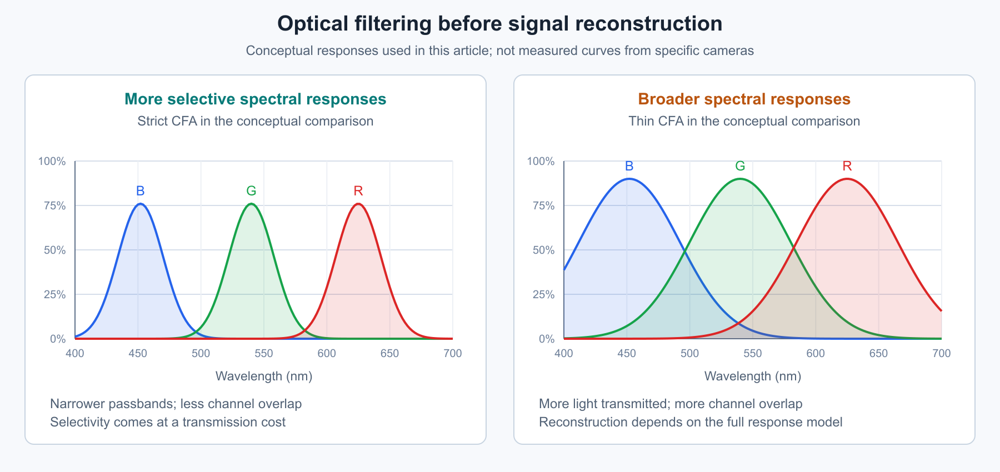
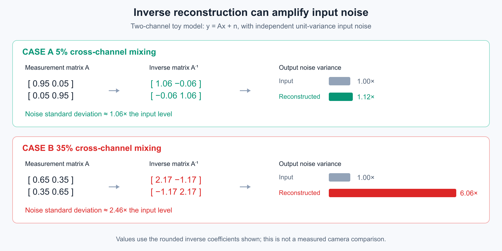
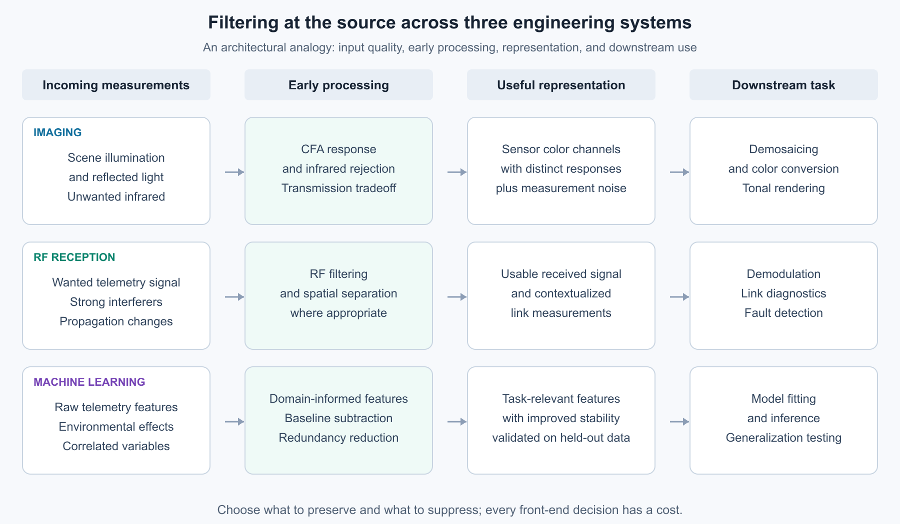

After getting used to modern mirrorless cameras with 40 or 50 megapixels, five-digit ISO settings, and a claimed 15 stops of dynamic range, it can still be surprising to revisit photographs from a Canon 5D Classic, a Nikon D700, or an earlier CCD camera. Models such as the Nikon D200, Pentax K10D, Minolta 7D, Leica M8 and M9, and Olympus E-1 can produce straight-out-of-camera colors that remain appealing. Skin looks clear, blues and greens feel restrained, and the image has a sense of depth that can be difficult to reproduce by adjusting curves in Lightroom.

Many photographers attribute this to larger pixels or nostalgia. But looking beyond specifications, toward sensor design, visual neuroscience, radio-frequency communications, and machine learning, suggests a common idea: **the cleaner the signal entering a system, the more its downstream processing can achieve.**

## 1 Raw Signals Are Not Always Useful Inputs

Should a signal-acquisition system accept everything from the physical world exactly as it arrives?

Biological vision and photographic film suggest otherwise. Both begin by discarding or suppressing parts of the incoming signal.

### Lateral inhibition in the retina

If the raw light-intensity signals received by the retinal cones were projected directly onto a screen, the result would be dim, low in contrast, and mixed with physiological noise. To prevent the brain from being overwhelmed by redundant information, the retina applies an early stage of filtering through lateral inhibition.

When a light-sensitive neuron receives a strong stimulus, inhibitory interactions affect neighboring neurons. In signal-processing terms, we can think of this as a form of spatial high-pass filtering before the information leaves the eye: slowly varying background brightness is suppressed, while edges and local contrast receive greater emphasis.

### Compression and chemical inhibition in color film

Color film offers another example. Whereas digital-camera specifications emphasize color accuracy and wide dynamic range, film builds part of its tonal and color response into its chemistry.

- **An S-shaped characteristic curve.** The response flattens in the highlight shoulder and the shadow toe. This compresses the extremes and gives the midtones a larger share of the useful tonal response.

- **Interlayer inhibition and DIR couplers.** Color film has red-, green-, and blue-sensitive layers. During development, developer-inhibitor-releasing couplers can release inhibitors that diffuse within and between layers, influencing contrast and color separation. Some of the interaction between color records is therefore managed chemically during development.

## 2 Two Approaches to Filtering Light at the Sensor

In both CMOS and CCD sensors, a photodiode does not independently identify the wavelength of each arriving photon. Its electrical output is a measurement of the light it receives, rather than a full spectral description.

To record color, manufacturers typically cover the sensor with a mosaic of red, green, and blue filters: the color filter array, or CFA. From a signal-processing perspective, this is a set of optical filters placed before the light is converted into electrical measurements.

For this discussion, consider two contrasting approaches to front-end design. The labels below describe conceptual choices, rather than standardized categories of camera sensors.

<figure class="article-figure">
  

  <figcaption>Figure 1 Optical filter responses in two conceptual CFA designs <a href="/assets/images/why-filtering-at-the-source-matters/conceptual-cfa-responses.png">View full size</a></figcaption>
</figure>

### Strict CFA and stronger spectral selectivity

Here, “Strict CFA” describes thicker dye filters with stronger spectral selectivity. The comparison connects this approach with digital SLRs from roughly 2001 to 2008, when film still strongly influenced color preferences, and with infrared and ultraviolet rejection elsewhere in the optical path.

In the conceptual illustration, the red, green, and blue transmission windows are narrow and largely separate. This reduces overlap at the input, at the cost of rejecting more light in the transition regions between the bands. The proposed comparison assumes a transmission loss of approximately 1.5 to 2 stops and groups the Canon 5D Classic, 1Ds Mark II, 1D Classic, Nikon D700, D3, D200, D60, Pentax K10D, Minolta 7D, Leica M8 and M9, and Olympus E-1 under this approach.

The Leica M8 provides an interesting example of the importance of infrared rejection. Its relatively thin infrared-cut filter allowed infrared contamination to affect some images. Black synthetic fabrics could appear magenta, leading users to fit UV/IR-cut filters to their lenses. When unwanted light enters the measurement, correcting its effect afterward can be difficult.

### Thin CFA and broader spectral transmission

Here, “Thin CFA” describes a design that favors higher transmission and broader spectral responses. This comparison links the approach to the shift after 2010 toward higher pixel counts, high-ISO performance, and 4K or 8K video.

For scale, pixel pitch falls from approximately 8.45 µm in a Nikon D700 to around 3.7 µm in some high-resolution full-frame sensors. The area of one pixel is then roughly $$\frac{1}{5}$$ as large. Increasing CFA transmission is one possible way to compensate for the smaller collection area.

In Figure 1, broader responses produce more overlap between channels. Light that contributes strongly to one channel can also contribute to the others, leaving downstream processing with more separation to perform.

## 3 What Downstream Processing Can and Cannot Recover

Why might it be difficult to make a modern RAW file look exactly like an image from an older camera, despite much greater processing power?

The data processing inequality points to a limit: downstream processing cannot create new information about an input that was not preserved in the measurements. When separation also requires inverting a poorly conditioned measurement model, the reconstruction can amplify noise.

### A two-channel numerical example

Consider a simplified relationship between the recorded signal $$y$$ and an underlying signal $$x$$:

$$y = Ax + n$$

Here, $$A$$ is a mixing matrix and $$n$$ represents noise. In this simplified example, reconstruction applies the inverse matrix $$A^{-1}$$. This illustrates the challenge of downstream separation, although a real camera's color-processing pipeline is more complicated.

Imagine two singers in a recording studio. With good acoustic separation, each microphone mainly records the singer in front of it. Without that separation, each recording contains more of both voices. Isolating one singer may then require boosting one recording and subtracting the other. Independent microphone noise does not cancel in the same way as the shared vocal content.

The same effect is visible in a $$2\times  2$$ example. Assume independent input noise with standard deviation $$\sigma  = 1$$ in each channel.

<figure class="article-figure">
  

  <figcaption>Figure 2 A two-channel example of noise amplification during inverse reconstruction <a href="/assets/images/why-filtering-at-the-source-matters/inverse-reconstruction-noise.png">View full size</a></figcaption>
</figure>

- **Case A with 5 percent mixing.** Let $$A = \left(\begin{matrix}0.95 & 0.05 \\ 0.05 & 0.95\end{matrix}\right)$$. The inverse is approximately $$A^{-1} \approx  \left(\begin{matrix}1.06 & -0.06 \\ -0.06 & 1.06\end{matrix}\right)$$. Using these rounded coefficients, the output noise variance in one channel is $$(1.06^{2} + (-0.06)^{2})\sigma ^{2} \approx  1.12 \sigma ^{2}$$. The standard deviation increases to about 1.06 times its original value.

- **Case B with 35 percent mixing.** Let $$A = \left(\begin{matrix}0.65 & 0.35 \\ 0.35 & 0.65\end{matrix}\right)$$. Its inverse is approximately $$A^{-1} \approx  \left(\begin{matrix}2.17 & -1.17 \\ -1.17 & 2.17\end{matrix}\right)$$. The output noise variance becomes $$(2.17^{2} + (-1.17)^{2})\sigma ^{2} \approx  6.06 \sigma ^{2}$$. Its standard deviation rises to about 2.46 times the input value.

An extra 30 percentage points of channel mixing produces more than five times as much reconstructed noise energy in this example. This is a conditioning problem in linear algebra. If stronger noise reduction is then applied, weak signal variations may also be smoothed away.

### Subtle color variation and highlight transitions

Small differences between the reddish and yellowish components of skin, or between shades of green in foliage, help create the impression of depth. One proposed explanation for the appeal of older cameras is that these differences survive without aggressive downstream noise reduction.

A similar argument can be made about highlights: different channel responses can affect how individual channels approach saturation. A gentle progression toward white is one of the qualities photographers associate with the highlight shoulder of film.

The following table summarizes the proposed comparison.

| **Aspect** | **Strict CFA in this comparison** | **Thin CFA in this comparison** |
| --- | --- | --- |
| Claimed strengths | Rich low-ISO color and subtle transitions Clear hue separation and local color contrast Gentler highlight transitions Greater tolerance of some older lenses' chromatic aberrations | Strong low-light and high-ISO performance Fast readout for bursts and video Wide dynamic range and substantial shadow-recovery latitude |
| Claimed tradeoffs | Estimated transmission loss of 1.5–2 stops Weaker high-ISO performance Lower resolution in the older cameras discussed | Greater reliance on color processing Potentially subdued color or visible chroma noise and smoothing when shadows are pushed |

ARRI ALEXA cinema cameras offer a broader example of prioritizing skin tones, color separation, and grading latitude through coordinated sensor and front-end design, rather than optimizing only for extreme ISO settings or compact bodies.

## 4 The Parallel in RF Networks and Machine Learning

The discussion becomes useful beyond photography when it is treated as an engineering analogy. RF receivers and machine-learning systems also face choices about which signals to retain, which interference to suppress, and how much separation to leave to downstream processing.

<figure class="article-figure">
  

  <figcaption>Figure 3 The source-filtering analogy across imaging RF reception and machine learning <a href="/assets/images/why-filtering-at-the-source-matters/source-filtering-across-systems.png">View full size</a></figcaption>
</figure>

### RF networks and interference rejection

In industrial IoT and large wireless telemetry networks, including systems operating around 450 MHz, received signals can include neighboring-channel interference, multipath effects, and environmental attenuation.

Filtering before a low-noise amplifier, or LNA, can prevent strong out-of-band signals from driving the amplifier into saturation. The placement involves a tradeoff, because filter insertion loss can also reduce weak-signal sensitivity. Once the front end clips or otherwise becomes nonlinear, downstream digital processing cannot simply recover the undistorted input.

At the network level, raw received signal strength, or RSSI, may also mix several effects. Seasonal vegetation can alter propagation, while local electrical equipment can contribute interference. A diagnostic system that treats every RSSI change as a device fault risks false alarms.

One approach combines directional separation, where beamforming is available, with analysis across time and neighboring nodes. The aim is to distinguish regional environmental changes from a sudden deterioration in an individual device's link.

### Machine learning and feature preparation

Data preprocessing is often reduced to removing duplicates, filling missing values, or deleting placeholder readings such as -999. These steps are useful, but they do not resolve every problem with the measurements or their representation.

Continue the telemetry example. Suppose a model must predict whether a wireless node will suffer degraded communication next week.

One approach is to feed it raw RSSI, temperature, relative humidity, dew point, and a seasonal vegetation index. These variables may be strongly related. RSSI itself also combines device behavior with environmental effects. A high variance inflation factor, $$VIF \gg  10$$, can indicate substantial multicollinearity.

For ordinary least squares under the usual assumptions, the coefficient covariance is:

$$\operatorname{Var}(\hat{W}) = \sigma ^{2} (X^{\mathsf{T}}X)^{-1}$$

When the columns of the design matrix are nearly linearly dependent, $$X^{\mathsf{T}}X$$ becomes poorly conditioned. This resembles the inverse-reconstruction problem in the two-channel example: small perturbations can have a large effect on the estimated coefficients.

If two features move together, a fitted model can assign them large coefficients with opposite signs. Consider a deliberately exaggerated example of +150 for temperature and -148 for dew point. Measurement error can then produce an unexpectedly large change in the prediction. A more complex model can also learn fragile correlations that fail when the season changes.

A source-filtering approach has several parts:

- **Use physical knowledge to separate effects.** Compare a node with nearby healthy nodes to estimate shared seasonal drift. Build features intended to describe residual link deterioration and unusual weather separately. A VIF below 2 could serve as an illustrative design target here, rather than a universal requirement.

- **Reduce redundant features.** Methods such as minimum redundancy maximum relevance, or mRMR, can help select features that retain useful information without excessive duplication. There is a further analogy with sparse autoencoders and hard gating in representation learning, where the aim is to obtain more distinct features.

- **Make the bias–variance tradeoff deliberately.** Discarding part of an input can introduce bias while reducing instability. The analogy is to rejecting some transition-band light at the sensor. Well-chosen, domain-informed features can sometimes be more useful than adding network depth or stronger L2 regularization alone.

## 5 Returning to the Photograph

Retinal inhibition, film chemistry, optical filtering, RF front ends, and feature engineering bring us back to a familiar principle: garbage in, garbage out. Problems with interference, measurement quality, and poorly separated inputs deserve attention before more downstream computation is added.

The practical lesson is to make deliberate choices at the source. Decide what needs to be measured, what can be discarded, and which distinctions the rest of the system will need to preserve.

Older cameras make this question tangible. Whatever combination of sensor response, optics, processing, and personal preference creates their appeal, they invite us to look beyond a specification sheet and ask how an image acquired its character in the first place.
